<p align="center">
  <a href="docs/images/cover.png">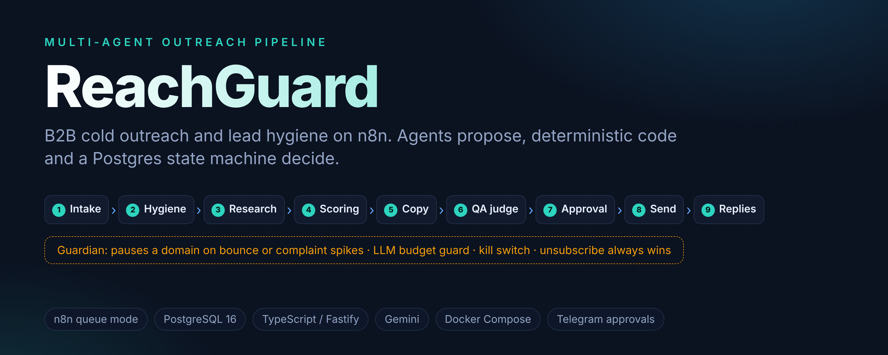</a>
</p>

<p align="center">
  
  
  
  
  
  
</p>

# ReachGuard

**A multi-agent B2B cold-outreach and lead-hygiene pipeline on n8n.**

ReachGuard takes raw B2B leads and turns them into compliant, evidence-backed outreach. Specialised agents research each company, score it, write the copy and judge it, but every step that can hurt a sender's reputation is decided by deterministic code and a Postgres state machine, never by a model's say-so.

Built by Muhammad Hassan, AI Automation Engineer & Full Stack Developer.

| | |
|---|---|
| Orchestration | n8n (queue mode, main + workers), 14 workflows generated from TypeScript |
| State | PostgreSQL 16 (`citext`, `pg_trgm`, `pgcrypto`), lead state machine in SQL |
| Service | `rg-tools`: Fastify + TypeScript (Zod, Ajv), LLM gateway, send adapters |
| Agents | Hygiene normaliser, research extractor, ICP scorer, copywriter, QA judge, reply classifier |
| Ops | Docker Compose, Mailpit, Metabase, Telegram alerts and approvals, GitHub Actions CI |

---

## At a glance

[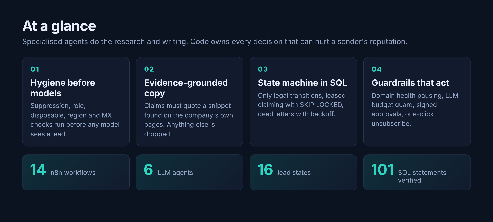](docs/images/overview.png)

---

## Contents

1. [What problem it solves](#what-problem-it-solves)
2. [What you get](#what-you-get)
3. [How each agent does its job](#how-each-agent-does-its-job)
4. [System architecture](#system-architecture)
5. [Pipeline flow](#pipeline-flow)
6. [Lead state machine](#lead-state-machine)
7. [The agents](#the-agents)
8. [Workflows](#workflows)
9. [Send and reply flow](#send-and-reply-flow)
10. [Safety layers](#safety-layers)
11. [Data model](#data-model)
12. [Modes](#modes)
13. [Screenshots](#screenshots)
14. [Quick start](#quick-start)
15. [Tests and evaluation](#tests-and-evaluation)
16. [Repository layout](#repository-layout)
17. [Documents](#documents)

---

## What problem it solves

Cold-outreach automation tends to fail in three ways:

1. It emails people it should never have emailed: role accounts, dead domains, opted-out contacts, regions that need consent.
2. It lets a language model write claims nobody checked.
3. It sends the same message twice when two workers race, and keeps sending after a domain's reputation has started to fall.

ReachGuard is built so each of those is hard to commit. Hygiene rules run before any model is called, copy claims must quote text found on the company's own pages, and a Guardian workflow pauses a sending domain when bounce or complaint rates cross a limit.

---

## What you get

**Outcome for a sales team:** a steady queue of researched, scored, personalised first emails that a person can approve from Telegram in one tap, sent from healthy domains inside business hours, with every reply and bounce handled automatically.

| Benefit | How the system delivers it |
|---|---|
| Cleaner lists | Role accounts, disposable and dead domains, duplicates, opted-out contacts and consent-required regions are stopped by rules before any model runs. |
| Copy you can defend | Each claim in an email quotes text found verbatim on the company's own page. A claim without a matching snippet is dropped. |
| No double sends | Leads are claimed with `SKIP LOCKED` and a lease, and every write is idempotent, so two workers cannot send the same message. |
| Sender reputation protected | A Guardian pauses a domain at 30 or more sends with bounce above 2% or complaints above 0.1%, enforces a daily LLM budget, and checks SPF, DKIM and DMARC every day. |
| Opt-outs honoured first | An unsubscribe keyword is matched by a rule before the reply classifier is called, and the suppression is written even when the lead cannot change state. |
| Humans stay in control | Approve, edit or reject drafts from Telegram. A kill switch stops sending. Live sending needs two explicit settings. |
| Visible results | Postgres views feed Metabase questions for funnel, hygiene, quality, sending health, replies and LLM cost. |

### What the system produces

- **Lead verdicts:** each lead ends in a clear state (`approved`, `in_sequence`, `replied`, `suppressed`, `rejected`, `needs_review`, `failed`) with the reason recorded.
- **Evidence-backed drafts:** a subject, body and the list of evidence ids each claim relies on.
- **Compliant messages:** physical address, a visible unsubscribe link, RFC 8058 one-click headers, threaded follow-ups, no tracking pixel.
- **Reply handling:** classified replies (interested, objection, not now, unsubscribe, out of office, bounce, wrong person) routed to a person, a pause or a suppression.
- **Audit trail:** events, LLM calls with cost, approvals and dead letters, all queryable in Postgres.

### Measured results

Run on a throwaway Postgres with the real service and the real workflow SQL (`make eval-local`). The full report is [docs/EVAL_REPORT.md](docs/EVAL_REPORT.md).

| Check | Result |
|---|---|
| Hygiene rules: planted bad leads caught with the right reason | 23 of 23 |
| Hygiene rules: clean leads wrongly blocked | 0 of 31 |
| Grounding precheck: detectable bad drafts caught | 12 of 12 |
| Grounding precheck: clean drafts wrongly failed | 0 of 6 |
| Unsubscribe keyword rule: opt-outs caught | 5 of 5 |
| Unsubscribe keyword rule: false hits on 35 other replies | 0 |
| Concurrent duplicate scenarios (lead, event, send) | 4 of 4 |
| Claim, lease and release scenarios | 3 of 3 |

[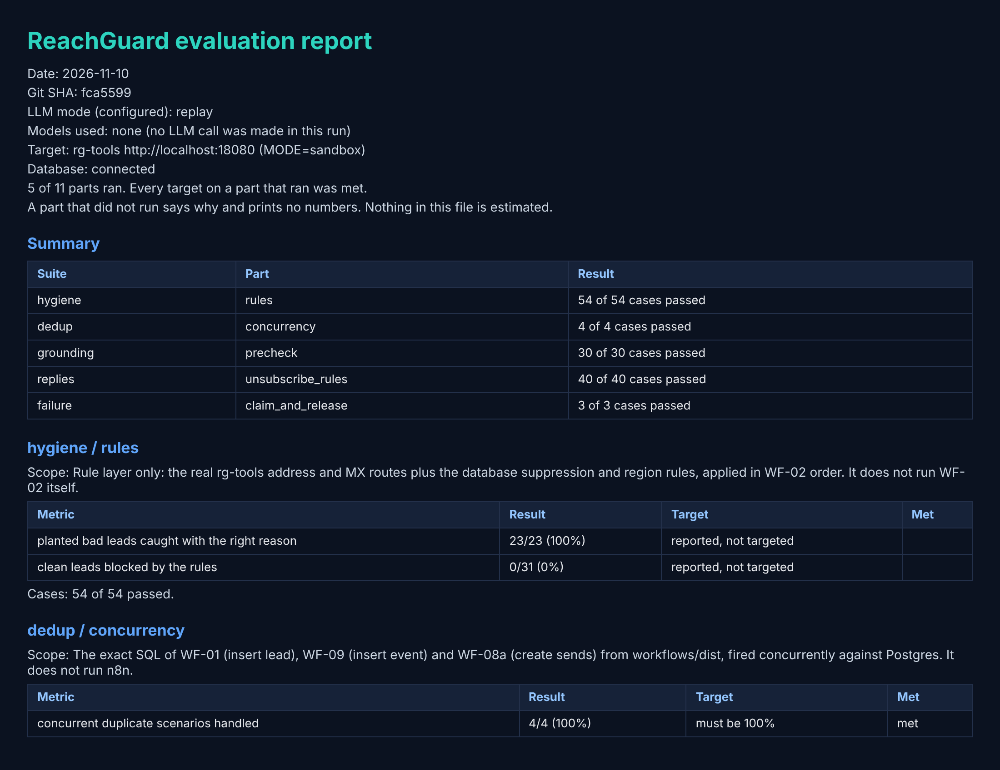](docs/EVAL_REPORT.md)

---

## How each agent does its job

| Agent | Problem it resolves | How |
|---|---|---|
| Hygiene normaliser | Messy names, titles and company strings, and unclear contacts | Rules decide block or pass. The model only tidies text, and low confidence (under 0.5) goes to human review. |
| Research extractor | Personalisation that is invented | Fetches the company's pages through an SSRF-guarded fetcher and returns claims with verbatim snippets. Claims that cannot be found in the page are removed. |
| ICP scorer | Wasting sends on poor-fit companies | Scores against weights in `config/defaults.yaml`, assigns a tier and rejects low fit with a stored reason. |
| Copywriter | Generic or unsupported copy | Writes the sequence from evidence ids that belong to the lead and rotates variants. |
| QA judge | A writer grading its own work | A separate call judges the draft. Code checks (grounding, banned phrases, subject length, links in the first email, question count) can override a lenient verdict, and a failed draft is revised. |
| Reply classifier | Slow or wrong handling of replies | Labels each reply after the keyword rule has run, then routes it to suppression, a pause, a human alert or nothing. |

Page text and replies are wrapped in `<untrusted_*>` tags, and no agent can send an email or write a suppression. Only deterministic steps do.

---

## System architecture

[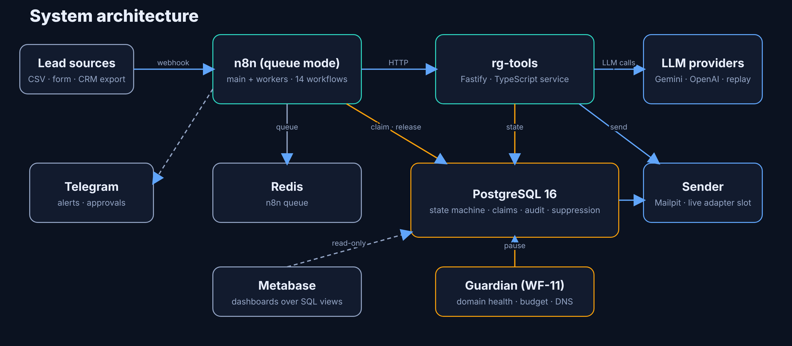](docs/images/architecture.png)

The same architecture as a diagram that renders from source:

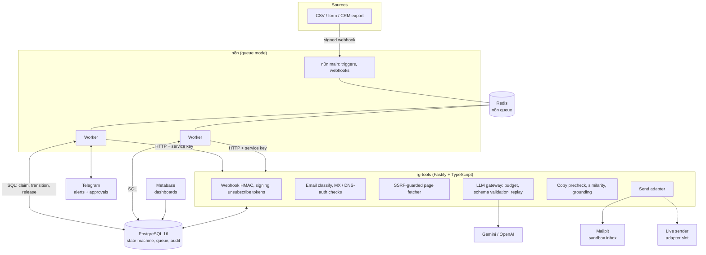

n8n cannot read environment variables in nodes or compute HMACs, so everything that needs a secret, DNS, page fetching, schema validation or a model call lives in `rg-tools`. n8n owns orchestration; Postgres owns state.

---

## Pipeline flow

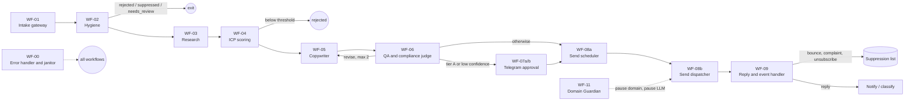

Stages never call each other. Each stage claims leads waiting in its input status (`claim_leads`, `FOR UPDATE SKIP LOCKED` with a lease), does its work, and moves them on with `transition_lead`. A crashed worker's leads become claimable again when the lease expires.

### What each stage decides

| Stage | Deterministic checks | Model's role |
|---|---|---|
| Intake | HMAC signature, 5-minute timestamp window, JSON-schema validation, idempotency key, one lead per email | none |
| Hygiene | suppression (email, domain, hash), role / disposable / free-provider, region rules, MX lookup, company cooldown and contact cap | normalise messy names and titles |
| Research | SSRF-guarded fetch, robots.txt, verbatim-snippet grounding | extract facts with evidence |
| Scoring | weighted ICP score, tier A/B/C, caps for catch-all and thin evidence | score the fit dimensions |
| Copy and QA | word counts, links, banned phrases, subject rules, evidence-id grounding, near-duplicate check | write the draft; judge it |
| Sending | send windows in the lead's time zone, jitter, inbox and domain caps, unsubscribe link and postal address | none |
| Replies | unsubscribe keyword rule runs first, bounce and complaint handling | classify the reply |

---

## Lead state machine

The database allows only the transitions below (`lead_status_transitions`). A workflow bug cannot move a lead somewhere illegal, and every move is written to `lead_transitions` with a reason and actor.

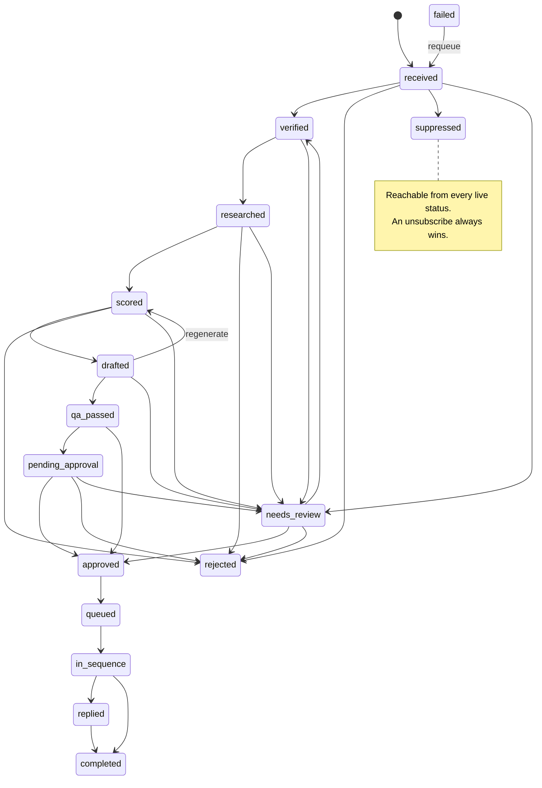

Leads that keep failing are released with exponential backoff; at the attempt cap they move to `failed` and a row is written to `dead_letters`.

---

## The agents

Each agent is a versioned prompt in `prompts/` with a JSON contract in `contracts/`. The LLM gateway validates every output with Ajv and retries once with the errors appended before recording `schema_invalid`.

| Agent | Prompt | Output contract | Guard rails |
|---|---|---|---|
| Hygiene normaliser | `hygiene-normalizer.md` | `normalize-output` | confidence under 0.5 goes to review |
| Research extractor | `research-extractor.md` | `research-output` | every claim needs a snippet found verbatim in the fetched page, otherwise it is dropped |
| ICP scorer | `icp-scorer.md` | `scoring-output` | weights and tier cut-offs live in `config/defaults.yaml` |
| Copywriter | `copywriter.md` | `copy-output` | can only cite evidence ids that belong to the lead |
| QA judge | `qa-judge.md` | `judge-output` | separate call; code checks can override a lenient verdict |
| Reply classifier | `reply-classifier.md` | `reply-classification` | an unsubscribe hit by the keyword rule is suppressed before this agent is called |

Page text and replies are wrapped in `<untrusted_*>` tags, and no agent can send an email or write a suppression. Only deterministic steps do.

---

## Workflows

Workflows are authored as TypeScript builders in `workflows/src/` and compiled to importable JSON in `workflows/dist/`, with deterministic node ids. A lint rejects `pinData`, credential values, execution data, unknown credentials and untagged workflows.

| ID | Workflow | Trigger | Purpose |
|---|---|---|---|
| WF-00 | Error handler and janitor | error trigger, schedule | alert dedupe, stuck-lead and dead-letter sweep |
| WF-01 | Intake gateway | signed webhook | validate, de-duplicate, insert leads |
| WF-02 | Hygiene agent | schedule | claim `received`, run the checks, normalise |
| WF-03 | Research agent | schedule | fetch pages, extract grounded evidence |
| WF-04 | ICP scoring agent | schedule | score, tier, reject low fit |
| WF-05 | Copywriter agent | schedule | write the sequence, rotate variants |
| WF-06 | QA and compliance judge | schedule | prechecks, judge, revise or pass |
| WF-07a | Approval dispatcher | schedule | send approval requests to Telegram |
| WF-07b | Approval callback | Telegram trigger | verify signed buttons, approve / edit / reject |
| WF-08a | Send scheduler | schedule | plan sends inside windows with jitter |
| WF-08b | Send dispatcher | schedule | caps, domain health, kill switch, send |
| WF-09 | Reply and event handler | signed webhook | bounces, complaints, replies, suppression |
| WF-11 | Domain Guardian | schedule | pause domains on bad rates, LLM budget guard, daily SPF / DKIM / DMARC check |
| WF-14 | Sandbox runner | manual | seed 60 synthetic leads and run the whole pipeline |

---

## Send and reply flow

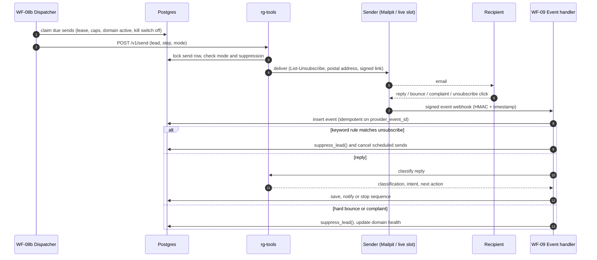

Unsubscribe is handled before any model call, so a model outage cannot lose an opt-out. `GET /u/:token` shows a confirmation page and only `POST` unsubscribes, because mail security scanners prefetch links.

---

## Safety layers

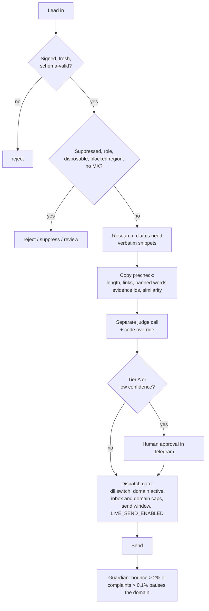

- **Idempotency:** unique indexes on the lead email and idempotency key, on `provider_event_id`, and on `(lead_id, step)` for sends, all with `ON CONFLICT DO NOTHING`.
- **Budget:** the gateway returns 429 when the daily LLM budget is spent; the Guardian sets `llm_paused` and resumes automatically.
- **Mode gates:** `MODE` must be set explicitly. Live sending needs `MODE=live` and `LIVE_SEND_ENABLED=true`. Sandbox sends can only reach a local SMTP sink, and sandbox data resets refuse to run in live mode.
- **Fetching:** http and https on ports 80 and 443 only; loopback, private, link-local and metadata ranges blocked after DNS resolution and redirects; size, time and redirect caps.
- **Secrets:** HMAC webhooks with constant-time comparison; n8n nodes cannot read the environment; the workflow lint rejects credential values.

More detail: [docs/COMPLIANCE.md](docs/COMPLIANCE.md).

---

## Data model

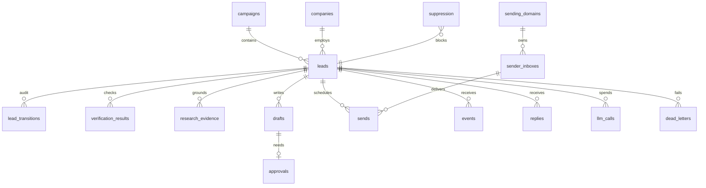

Also in the schema: `settings` (kill switch, LLM pause and budget, Telegram chat ids), `region_rules`, `lead_status_transitions`, `runs`, `prompt_versions`, `eval_runs`, `eval_results`, and the views behind the dashboards (`v_funnel`, `v_domain_health_rates`, `v_cost_per_lead`, `v_variant_performance`, `v_llm_spend_today`). Migrations live in `db/migrations/`.

Dashboards: [db/views/metabase-questions.md](db/views/metabase-questions.md).

---

## Modes

| | Sandbox (default) | Live |
|---|---|---|
| `MODE` | `sandbox` | `live` |
| Sender | Mailpit inbox at `localhost:8025` | live sender adapter, needs `LIVE_SEND_ENABLED=true` |
| MX / DNS checks | synthetic resolver for fixture domains | real DNS |
| Email verifier | tag-driven sandbox verifier | verifier adapter slot |
| Data | 60 synthetic leads, 40 labeled replies, 27 fixture sites | your leads |
| Reset routes | enabled | refuse to run |

### Integration adapters

| Adapter | Interface | Shipped implementation |
|---|---|---|
| Sender | `SenderAdapter` | Mailpit (sandbox); live adapter slot |
| Email verifier | `Verifier` | sandbox verifier; live adapter slot |
| LLM provider | `LlmProvider` | Gemini and OpenAI, plus replay from recorded fixtures |
| Events | normaliser per provider | sandbox events; provider slot |

The live slots throw `NotConfigured` until a vendor adapter is added, so nothing can be sent by accident.

---

## Screenshots

### Workflows in n8n

Captured from the generated workflows imported into n8n.

**WF-09 Reply and Event Handler**: signature check, event dedupe, routing of bounces, complaints, unsubscribes and replies.

[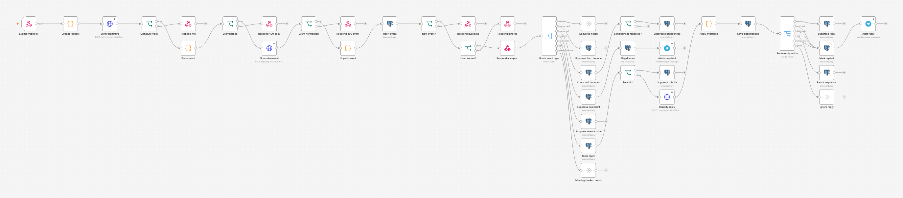](docs/images/workflows/wf-09-reply-handler.png)

**WF-07b Approval Callback**: signed Telegram buttons for approve, edit and reject.

[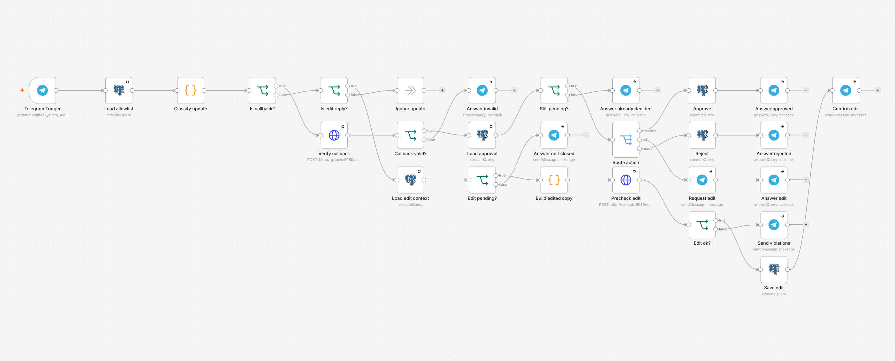](docs/images/workflows/wf-07b-approval-callback.png)

**WF-11 Domain Guardian**: bounce and complaint limits, budget guard and DNS checks.

[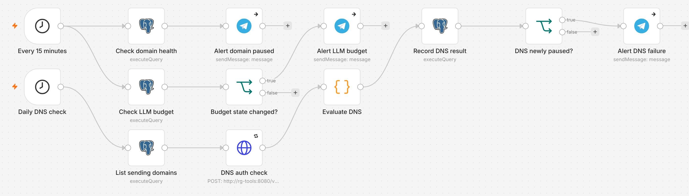](docs/images/workflows/wf-11-domain-guardian.png)

<details>
<summary>More workflows</summary>

**WF-01 Intake Gateway**

[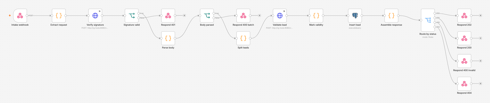](docs/images/workflows/wf-01-intake.png)

**WF-03 Research Agent**

[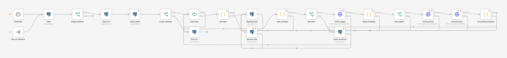](docs/images/workflows/wf-03-research.png)

**WF-05 Copywriter Agent**

[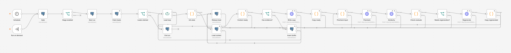](docs/images/workflows/wf-05-copywriter.png)

**WF-06 QA and Compliance Judge**

[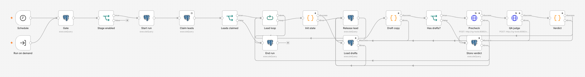](docs/images/workflows/wf-06-qa-judge.png)

**WF-08b Send Dispatcher**

[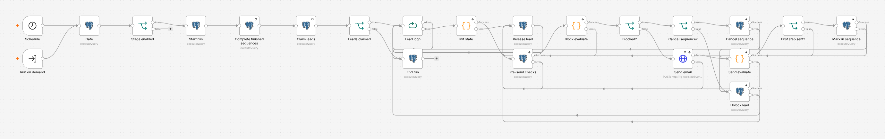](docs/images/workflows/wf-08b-send-dispatcher.png)

</details>

### An outbound message

Built by the real message builder: visible address, unsubscribe link, one-click headers, deterministic Message-ID. The recipient and body text are sample data.

[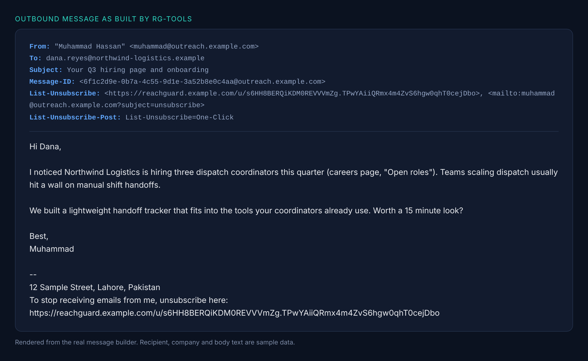](docs/images/email-sample.png)

---

## Quick start

Requirements: Docker, Node 22.

```bash
cp .env.example .env            # fill the change-me values; set MODE=sandbox; pin N8N_VERSION
make up                         # postgres, redis, n8n, workers, rg-tools, mailpit
make migrate && make seed
make build-workflows && make import-workflows
set -a; . ./.env; set +a
node scripts/create-credentials.mjs
TELEGRAM_ALERT_CHAT_ID=<id> bash scripts/seed-settings.sh   # optional, for Telegram
docker compose --profile dashboard up -d metabase           # optional dashboards
```

Open n8n at http://localhost:5678, activate the workflows and run **WF-14 Sandbox runner**. Emails appear in Mailpit at http://localhost:8025. Step-by-step walkthrough: [docs/DEMO_SCRIPT.md](docs/DEMO_SCRIPT.md).

The agents call an LLM, so set `GEMINI_API_KEY` (or an OpenAI key) and `LLM_MODE=live`. `LLM_MODE=replay` serves recorded fixtures; the runbook explains how to record them.

---

## Tests and evaluation

```bash
make test                # database, rg-tools (with Postgres) and workflow tests
make lint
make check-workflow-sql  # prepares every workflow SQL statement against the migrated schema
make validate-sandbox    # seed data against the contracts
make eval-local          # evaluation on a throwaway Postgres, writes docs/EVAL_REPORT.md
```

- **Unit and contract tests:** rg-tools (442), workflows (113), evaluation harness (37), plus SQL tests for the state machine, claims and views.
- **Evaluation suites:** hygiene rules against planted bad leads, grounding against 30 planted drafts, prompt-injection fixtures, labeled replies, concurrent-duplicate scenarios, and claim / lease / release scenarios. Parts that call a model run when an API key is configured.
- **CI** (`.github/workflows/ci.yml`): lint and typecheck, unit tests, schema tests on Postgres 16, workflow build and lint, contract validation, replay evaluation, secret scan, image scan, and an optional nightly live evaluation.

The report states which parts ran and prints numbers only for those. See [docs/EVAL_REPORT.md](docs/EVAL_REPORT.md).

---

## Repository layout

```
reachguard/
├── contracts/          JSON schemas for intake and every agent output
├── prompts/            versioned agent prompts
├── config/             thresholds, weights, send windows (defaults.yaml)
├── db/                 migrations, seeds, SQL tests, Metabase questions
├── services/rg-tools/  Fastify service: gateway, adapters, routes, tests
├── workflows/          TypeScript builders, lint, dist/ (importable JSON)
├── sandbox/            60 leads, 40 replies, suppression seed, 27 fixture sites
├── eval/               evaluation harness and planted cases
├── scripts/            import, credentials, settings, DB tests, eval, secret scan
├── docs/               architecture, runbook, compliance, demo, case study
├── docker-compose.yml
└── Makefile
```

---

## Documents

[ARCHITECTURE](docs/ARCHITECTURE.md) · [RUNBOOK](docs/RUNBOOK.md) · [COMPLIANCE](docs/COMPLIANCE.md) · [DEMO_SCRIPT](docs/DEMO_SCRIPT.md) · [EVAL_REPORT](docs/EVAL_REPORT.md) · [CASE_STUDY](docs/CASE_STUDY.md) · [SPEC](docs/SPEC.md)

Deliverability depends on domain authentication, warmup, content and list quality, which software cannot guarantee. This is engineering guidance, not legal advice.
