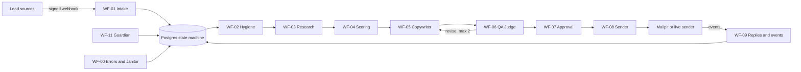

# Architecture

## Components

| Component | Role |
|---|---|
| n8n (queue mode, main + workers) | Orchestration. Each pipeline stage is a workflow that claims leads, calls rg-tools, writes results. |
| PostgreSQL 16 | All state. `citext`, `pg_trgm`, `pgcrypto`. The lead state machine and claim/lease logic live in SQL. |
| Redis | n8n queue. |
| rg-tools (Fastify, TypeScript) | Everything n8n nodes cannot do: secrets, HMAC, DNS, page fetching with SSRF guard, schema validation, LLM gateway, send adapter, scheduling. |
| Mailpit | Sandbox SMTP sink and web inbox. |
| Metabase (optional) | Dashboards over SQL views, see `db/views/metabase-questions.md`. |
| Telegram (optional) | Alerts and approvals. |

## Pipeline

## Design decisions

**Pull-based orchestration.** Stages do not call each other. A stage claims leads in its input status with `claim_leads(status, limit, worker, lease)`, which uses `FOR UPDATE SKIP LOCKED` and a lease, so concurrent workers never receive the same lead and a crashed worker's leads become claimable again when the lease expires. A failing lead is returned with `release_lead`, which backs off exponentially and, at the attempt cap, moves the lead to `failed` and writes a dead letter.

**The database owns the state machine.** `transition_lead(lead, from, to, reason, actor)` only allows transitions listed in `lead_status_transitions` and writes `lead_transitions`. A workflow bug cannot move a lead to an illegal state.

**Agents propose, code decides.** LLM output is schema-validated (Ajv, JSON contracts in `contracts/`) and retried once with the errors appended. Research claims must carry a verbatim snippet and are kept only if the snippet occurs in the fetched page. The QA judge is a separate call, and WF-06 applies code checks that override a lenient judge. No agent sends email or writes a suppression; only deterministic steps do.

**Untrusted text is data.** Page content and replies are wrapped in `<untrusted_*>` tags defined in each prompt, and outputs are scanned in the evaluation for planted instructions.

**Idempotency.** Lead inserts use an idempotency key and a unique email index with `ON CONFLICT DO NOTHING`; events are unique on `provider_event_id`; sends are unique on `(lead_id, step)`.

**Modes and adapters.** Sandbox and live implementations share interfaces (`SenderAdapter`, verifier, LLM provider). Live sending requires `MODE=live` and `LIVE_SEND_ENABLED=true`.

**Workflows as code.** `workflows/src/*.ts` builds the JSON with deterministic node ids; a lint rejects `pinData`, credential values, execution data, unknown credentials and untagged workflows. `scripts/check-workflow-sql.sh` extracts every SQL statement and prepares it against the real migrated schema.

## Failure handling

| Failure | Behaviour |
|---|---|
| Worker crash mid-lead | Lease expires, lead is claimed again. |
| Stage error | `release_lead` with backoff; at the cap, status `failed` plus a dead letter and a Telegram alert. |
| LLM budget exhausted | rg-tools returns 429, Guardian sets `llm_paused` with reason `budget` and resumes automatically next day. |
| Bounce or complaint spike | Guardian pauses the domain and its inboxes. |
| Transient DNS error | Never pauses a domain; only a definite SPF/DKIM/DMARC failure alerts. |
| Duplicate webhook or event | Absorbed by the unique indexes above. |

## Data

Schema in `db/migrations/0001_init.sql`, seeds in `db/seeds/`, schema tests in `db/tests/`. Contracts in `contracts/`, prompts (with versioned front matter) in `prompts/`, thresholds in `config/defaults.yaml`.
